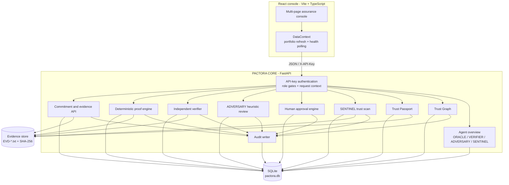
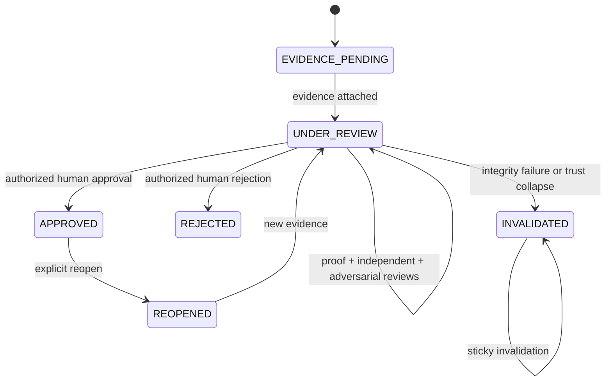

<div align="center">

# PACTORA

### Trust should be demonstrated, not just declared.

**A local-first, proof-carrying commitment network for evidence integrity, adversarial review, human approval, trust collapse detection, and inspectable assurance.**

[Problem](#the-problem) &middot; [Solution](#the-pactora-solution) &middot; [Guided Demo](#the-seven-stage-guided-demonstration) &middot; [Architecture](#architecture) &middot; [Security](#security-and-trust-model) &middot; [AI-Assisted Engineering](#ai-assisted-engineering-and-security-hardening) &middot; [Attribution](#engineering-attribution) &middot; [Quick Start](#installation-and-local-setup) &middot; [API](#api-reference) &middot; [Limitations](#implemented-vs-not-implemented)


</div>

---

## Why PACTORA exists

Organizations make claims every day:

- "Customer data is encrypted at rest."
- "Access reviews happen quarterly."
- "This control is operating effectively."
- "The vendor met the security requirement."

Most systems store the claim. Fewer store the evidence. Almost none preserve the *relationship* between the claim, the evidence, the review, the approval, and the moment trust should have changed.

PACTORA is built around a stricter question:

> **What exactly is known, what was verified, who approved it, and what remains unproven?**

PACTORA makes that question executable.

It connects a business commitment to a concrete evidence artifact, a SHA-256 fingerprint, deterministic acceptance checks, an independent recheck, an adversarial review, a human approval decision, continuous integrity checks, dependency-aware trust collapse, and a Trust Passport that explicitly states its own limits.

This is not a blockchain. This is not an AI oracle. It does not claim to prove business truth. It proves that a particular evidence file still matches its recorded fingerprint, that configured checks passed or failed, that reviews were recorded against a particular evidence snapshot, and that a human made an accountable decision at a particular moment.

**Proof over promises.**

---

## The problem

### 1. Claims outlive their evidence

A commitment is often created once, while the evidence behind it changes, expires, or disappears. Without a durable link between the two, trust becomes institutional memory rather than inspectable state.

### 2. Integrity is assumed instead of tested

Teams usually know that a file exists. They rarely know whether the exact bytes reviewed yesterday are the same bytes present today. A filename is not proof. A folder is not a control.

### 3. Verification is often a claim about a claim

A checkbox saying "verified" is not the same as a reproducible check. PACTORA separates file integrity, deterministic acceptance checks, and independent re-evaluation so each can be inspected on its own.

### 4. Reviews hide their own limitations

Most review workflows report pass/fail without preserving uncertainty. PACTORA's ADVERSARY engine records explicit limitations such as single-source evidence, text-only evidence, missing acceptance checks, and the fact that semantic truth was not established.

### 5. Approval can drift away from the evidence

An approval is only meaningful if it is tied to the evidence state that was actually reviewed. PACTORA snapshots evidence around reviews and re-checks freshness at the moment of approval.

### 6. Trust failures do not stay local

When one commitment depends on another, a failed prerequisite can invalidate everything downstream. PACTORA models dependencies explicitly and propagates trust collapse through the Trust Graph.

### 7. Demonstrating a failure mode is dangerous

A convincing trust demo must show evidence changing. Doing that against the real application database would be irresponsible. PACTORA's guided demonstration therefore has an isolated execution path with a separate SQLite database and evidence directory.

---

## The PACTORA solution

PACTORA is a working local application composed of a FastAPI backend, a React console, a SQLite database, and an evidence store.

```text
Business claim
   v
Commitment
   v
Evidence artifact + SHA-256 fingerprint
   v
Integrity verification
   v
Deterministic proof checks
   v
Independent recheck
   v
ADVERSARY review
   v
Human approval
   v
SENTINEL integrity monitoring
   v
Trust collapse, dependency propagation, and Trust Passport
   v
Audit trail
```

### Core capabilities

| Capability | What it actually does |
|---|---|
| **Commitments** | Records a title, claim, owner, acceptance criteria, status, and creation time. |
| **Evidence** | Stores the artifact under a generated `EVD-*.txt` name and records its SHA-256 fingerprint. The supplied filename is only a label. |
| **Integrity verification** | Recomputes SHA-256 for every evidence file and compares it with the stored fingerprint. Missing or unreadable files fail closed. |
| **Deterministic proof checks** | Runs explicit `contains` or `equals` checks against intact evidence. Unsupported operators are inconclusive. |
| **Independent review** | A separate reviewer identity re-runs configured checks instead of trusting saved evaluation output. |
| **ADVERSARY** | Applies explicit heuristic rules to surface evidence weaknesses and semantic limits. |
| **Human approval** | Requires an approver role, a configured approver ID, and an approval token. Re-checks evidence integrity and review freshness inside the approval transaction. |
| **SENTINEL** | Recomputes fingerprints, supports dry-run scans, validates reachable dependency edges, and invalidates the root plus transitive dependents on collapse. |
| **Trust Graph** | Stores explicit `DEPENDS_ON` edges, prevents self-dependencies and cycles, and propagates invalidation from prerequisites to dependents. |
| **Trust Passport** | Produces an unsigned, inspectable assurance snapshot with evidence, proof history, verification history, adversarial history, approval history, audit trail, and trust summary. |
| **Audit trail** | Records commitment events with actor and request metadata where supplied. There are no update or delete routes for audit events. |
| **Agent overview** | Derives ORACLE, VERIFIER, ADVERSARY, and SENTINEL reports from actual backend records. No fabricated activity. |
| **Guided demonstration** | Runs the complete lifecycle, including evidence tampering and trust collapse, in an isolated SQLite/evidence environment. |

### What makes the design different

PACTORA is intentionally **proof-carrying**, not certainty-performing.

- The evidence fingerprint is recorded at storage time and checked again later.
- Proof evaluation refuses to trust evidence whose current hash no longer matches the stored hash.
- Reviews are bound to evidence snapshots.
- Approval re-checks the snapshot immediately before committing the decision.
- Invalidated commitments are sticky: new evidence and approval are blocked.
- The Trust Passport explicitly preserves limitations and sets `claim_semantically_verified` to `false`.
- The demo's destructive step is isolated from the real database and evidence directory.

---

## Visual product demonstration

> **Screenshot status:** this repository does not currently contain committed screenshot assets. No fake screenshots or stock images are used in this README. Add real captures using the instructions below.

### Recommended captures

| Screen | Suggested file | What it demonstrates |
|---|---|---|
| Executive Overview | `docs/screenshots/01-overview.png` | Portfolio trust state, approval queue, agent activity, evidence posture |
| Guided Demonstration | `docs/screenshots/02-guided-demo.png` | Seven-stage workflow and live record |
| Trust Passport | `docs/screenshots/03-trust-passport.png` | Evidence, proof, reviews, approval, audit trail, limitations |
| Trust Graph | `docs/screenshots/04-trust-graph.png` | Dependency topology and collapse propagation |
| ADVERSARY | `docs/screenshots/05-adversary.png` | Recorded findings and limitation boundaries |
| SENTINEL collapse | `docs/screenshots/06-sentinel-collapse.png` | Failed evidence, invalidated commitment, blocked re-attestation |

### How to add screenshots

1. Launch the isolated demonstration using the commands in [Safe guided demo](#safe-guided-demo).
2. Open the relevant screen at `http://127.0.0.1:5174/...`.
3. Capture a clean browser window at approximately `1440x900`.
4. Save the PNG files under `docs/screenshots/` using the names above.
5. Replace this block with the actual image embeds once the assets exist.

<!--
After capturing real screenshots, add them here:


-->

---

## The seven-stage guided demonstration

The guided demonstration is not a mock. It exercises real backend endpoints against a real SQLite database and real evidence files. The difference is that the safe launcher binds the backend to an isolated demo environment.

### Stage map

| Stage | Action | Backend behavior | Demonstrated result |
|---|---|---|---|
| **01** | Create commitment | Inserts a commitment with status `EVIDENCE_PENDING` | Commitment created |
| **02** | Attach evidence | Stores the artifact, computes SHA-256, moves status to `UNDER_REVIEW` | Evidence stored in isolated directory |
| **03** | Verify the proof | Runs integrity verification, deterministic proof checks, and independent review | Integrity `PASS`; proof `PASS`; independent review `PASS` |
| **04** | Run ADVERSARY | Applies heuristic review rules and records findings | `LIMITATIONS_IDENTIFIED` with 3 findings |
| **05** | Record human approval | Validates approver role, token, gates, and evidence snapshot freshness | Approval recorded; status `APPROVED` |
| **06** | Break trust, then detect it | Appends a demo marker to the isolated evidence file, then runs SENTINEL | SENTINEL `COLLAPSED`; commitment `INVALIDATED` |
| **07** | Inspect the collapsed passport | Generates Trust Passport and attempts new evidence | Passport shows collapse; new evidence blocked |

### Actual isolated demonstration result

Verified in the current workspace:

```text
7/7 stages completed
Integrity PASS before tampering
Proof PASS
Independent review PASS
ADVERSARY: LIMITATIONS_IDENTIFIED with 3 findings
Human approval recorded
SENTINEL: COLLAPSED after evidence modification
One failed evidence record
One affected commitment
Commitment INVALIDATED
New evidence blocked
Trust Passport shows COLLAPSED evidence integrity
Approval remains visible in the passport history
Audit trail contains DEMO_EVIDENCE_TAMPERED and TRUST_COLLAPSE_DETECTED
```

The original database and evidence directory were fingerprinted before and after the run and remained unchanged. The isolated state was then removed automatically.

These are **isolated guided-demo results**, not production benchmarks or real-world assurance claims.

### The three ADVERSARY findings in the demo

For the demonstration scenario, ADVERSARY records:

1. `SINGLE_EVIDENCE_SOURCE` - only one evidence item is available; independent corroboration is absent.
2. `TEXT_BASED_EVIDENCE` - the evidence is a text/log file and does not independently establish real-world truth.
3. `SEMANTIC_TRUTH_NOT_ESTABLISHED` - configured checks cannot independently prove the complete business claim.

The result is `LIMITATIONS_IDENTIFIED`, not `CHALLENGED`, because no critical findings are present.

### Why isolation matters

The original `frontend/src/pages/Demo.tsx` calls the real backend endpoints, including the demo tamper endpoint. In the normal application layout, that endpoint would modify the evidence file referenced by the real database.

The safe demonstration solves this without changing the production application configuration:

- `backend/demo/isolation.py` creates a separate state directory and refuses production paths.
- `backend/demo/run_isolated.py` imports the application and rebinds `main.DATA_DIR`, `main.DB_PATH`, and `main.EVIDENCE_DIR` in process memory only.
- `backend/demo/verify_guided_demo.py` proves the seven stages work while hashing the original database and every original evidence file before and after.

No change is made to `backend/app/main.py`, `backend/.env`, `frontend/.env`, or `frontend/vite.config.ts` by the isolation mechanism.

### Safe guided demo

**Terminal 1 - isolated backend**

```powershell
cd C:\Users\ASUS\develop\PACTORA
python -m backend.demo.run_isolated --reset --port 8011
```

**Terminal 2 - UI pointed at the isolated backend**

```powershell
cd C:\Users\ASUS\develop\PACTORA\frontend
$env:VITE_API_BASE="http://127.0.0.1:8011"
npm run dev -- --port 5174
```

Open:

```text
http://127.0.0.1:5174/demo
```

Do **not** run the guided demo through the normal Vite proxy without checking its backend target. The standard proxy points `/api` at `http://127.0.0.1:8000`, which is the normal application path.

### Reset the isolated demo

Stop the isolated backend, then run:

```powershell
python -m backend.demo.run_isolated --reset --state-dir "C:\Users\ASUS\develop\PACTORA\runtime-demo\guided-demo" --port 8011
```

This removes only the isolated demo state. The original `backend/data/pactora.db` and `backend/evidence/` are not touched.

### Re-run the isolation proof

```powershell
python -m backend.demo.verify_guided_demo
```

The verifier creates a temporary database and evidence directory, runs all seven stages, compares the original state fingerprints, and cleans up.

---

## Architecture

PACTORA is deliberately small enough to inspect end to end.

- **Frontend:** React + TypeScript single-page console served by Vite.
- **Backend:** FastAPI application in `backend/app/main.py`.
- **API communication:** JSON over HTTP with `X-API-Key`; approval additionally requires `X-Approval-Token`.
- **Persistence:** SQLite database at `backend/data/pactora.db`.
- **Evidence storage:** files under `backend/evidence/` using generated names such as `EVD-*.txt`.
- **Trust Graph:** explicit commitment dependency edges in SQLite.
- **Audit:** event rows with actor and request metadata.
- **Guided demo isolation:** separate SQLite database and evidence directory under `runtime-demo/` by default.

### System diagram



### Trust lifecycle


### Commitment state machine



---

## Trust Passport

The Trust Passport is an unsigned, generated snapshot. It is intended to be inspectable, not magical.

It contains:

- Commitment identity and status.
- Evidence records with recorded and current SHA-256 values.
- Evidence integrity state: `INTACT`, `COLLAPSED`, or `NOT_AVAILABLE`.
- Configured proof checks and proof evaluation history.
- Independent verification history.
- ADVERSARY history and findings.
- Human approval history and latest decision.
- The full audit trail for the commitment.
- A trust summary.
- Explicit limitations.
- `claim_semantically_verified: false`.

The passport is generated on demand from the database and current evidence files. It does not sign itself, certify authenticity, or establish that the business claim is true.

---

## ADVERSARY

ADVERSARY is a **heuristic review engine**, not an autonomous reasoning model.

Implemented rules:

| Code | Severity | Trigger |
|---|---|---|
| `NO_EVIDENCE` | CRITICAL | No evidence is attached. |
| `SINGLE_EVIDENCE_SOURCE` | WARNING | Exactly one evidence item exists. |
| `TEXT_BASED_EVIDENCE` | WARNING | All evidence files are text/log/JSON-like. |
| `NO_ACCEPTANCE_CHECKS` | CRITICAL | No deterministic proof checks exist. |
| `SEMANTIC_TRUTH_NOT_ESTABLISHED` | WARNING | Always recorded because configured checks cannot prove the complete claim. |

A critical finding produces `CHALLENGED`. Otherwise the result is `LIMITATIONS_IDENTIFIED`.

Review records are persisted and bound to an evidence snapshot. The review result is not treated as semantic truth.

---

## SENTINEL

SENTINEL is the integrity and trust-collapse engine.

For a commitment it:

1. Reads every evidence record.
2. Recomputes the current SHA-256 for each file.
3. Marks missing, unreadable, or mismatched files as failed.
4. Supports a `dry_run` mode that reports what would happen without mutating state.
5. Validates reachable dependency edges for malformed relationships.
6. Collects the root commitment and all transitive dependents.
7. Invalidates the affected commitments and writes `TRUST_COLLAPSE_DETECTED` audit events.

A trust scan is currently **on demand** through the API. There is no background scheduler or daemon in this version.

---

## Trust Graph

Dependencies are explicit records, not inferred from UI labels.

- An edge means: `commitment_id` requires `depends_on_id`.
- Self-dependencies are rejected.
- Duplicate dependencies are rejected.
- Cycles are rejected using a recursive SQL CTE.
- Approved commitments must be reopened before dependency changes.
- Invalidated commitments cannot be changed or used as prerequisites.
- A trust collapse propagates from a failed prerequisite to all transitive dependents.

The graph API returns nodes and edges for the full portfolio or a single commitment.

---

## Security and trust model

### Authentication and authorization

PACTORA uses a local-demo API-key model with role-based gates.

- If no API key is configured, the application fails closed with `503`.
- A single key can be configured with `PACTORA_API_KEY`, `PACTORA_PRINCIPAL_ID`, `PACTORA_PRINCIPAL_ROLE`, and `PACTORA_PRINCIPAL_NAME`.
- Multiple principals can be configured with `PACTORA_API_KEYS` as a JSON object.
- Roles used by the code: `admin`, `owner`, `reviewer`, `approver`, and `service`.
- `admin` bypasses role gates but still operates through the same request path.
- Principals with the `owner` role are scoped to commitments they own; reviewer, approver, and service roles receive read access as required by their role.
- The `/` and `/health` endpoints are public; all other routes require authentication.

### Approval controls

Approval is intentionally stricter than a normal write:

- Requires the `approver` role.
- Requires the request header `X-Approval-Token` to match `PACTORA_APPROVAL_TOKEN`.
- Requires the payload `approver_id` to match `PACTORA_APPROVER_ID`.
- Requires a latest proof result of `PASS`.
- Requires a latest independent review result of `PASS`.
- Requires an adversarial review to exist.
- Requires zero unresolved critical adversarial findings.
- Requires proof, verification, and adversarial review snapshots to match the current evidence snapshot.
- Re-checks evidence integrity and snapshot consistency immediately before the write.
- Writes approval history, commitment status, and audit event in one `BEGIN IMMEDIATE` transaction.

### Evidence integrity

- Evidence is written under a generated identifier, not the user-supplied path.
- SHA-256 is computed when the evidence is stored.
- Integrity checks recompute the hash from current file bytes.
- Missing or unreadable evidence fails closed.
- Proof evaluation refuses to trust content when the current hash does not match the recorded hash.

### State transition restrictions

- `INVALIDATED` commitments reject new evidence.
- `INVALIDATED` commitments reject approval and rejection.
- `INVALIDATED` commitments cannot be reopened in this version.
- `APPROVED` commitments reject new evidence until explicitly reopened.
- Only `APPROVED` commitments can be reopened.
- Reopening records an audit event and sets status to `REOPENED`.
- New evidence on a reopened commitment moves it back to `UNDER_REVIEW`.

### Audit

- Audit events are inserted by the application.
- There are no update or delete routes for audit events.
- Events include actor metadata when a principal is available.
- Request IDs are accepted from `X-Request-ID` or generated by middleware.
- Responses include the `X-Request-ID` header.

### Demonstration isolation

- The destructive demonstration step requires `PACTORA_DEMO_MODE=1`.
- The safe launcher creates a separate SQLite database and evidence directory.
- Production path guards reject the real database and evidence directory.
- The verifier fingerprints the original database and all original evidence files before and after the workflow.

### Explicit limitations

PACTORA does **not** claim:

- That SHA-256 proves evidence authenticity. It detects changes relative to a stored hash.
- That the evidence store is tamper-proof or write-once.
- That the Trust Passport is signed or externally verifiable.
- That deterministic checks establish the semantic truth of a business claim.
- That ADVERSARY is an AI reasoning system.
- That the local API-key model is production identity management.
- That the application has been hardened for public internet deployment.
- That data at rest is encrypted by PACTORA.
- That multi-tenant isolation extends beyond the implemented owner/role checks.
- That rate limiting, secrets rotation, centralized logging, or a background monitoring daemon are implemented.

These are boundaries, not marketing footnotes. The product is designed to make them visible.

---

## AI-Assisted Engineering and Security Hardening

PACTORA's backend security hardening was developed in a Switch Console multi-agent collaboration. The record was reconstructed from the Switch Console repository and its local PACTORA agent-session data, then cross-checked against the current PACTORA source and a fresh test run. Switch Console was the collaboration environment; its local session data and credentials are not part of this repository.

PACTORA combines four engineering layers:

1. **Product engineering** - the commitment, evidence, proof, review, approval, trust-collapse, and Trust Passport model.
2. **AI-assisted development** - Antigravity-assisted frontend work and Switch-assisted backend security work.
3. **Security hardening** - authentication, authorization, immutable approved states, atomic approval, and restricted trust scans.
4. **Automated verification** - 56 backend tests, frontend typecheck, and the isolated guided demo.

Switch did **not** independently develop the entire product. The human owner set the product direction, threat priorities, security constraints, and acceptance criteria. Antigravity assistance is associated with the frontend. Switch specialist sessions handled the backend security review, implementation, and verification described here.

### Recorded Switch collaboration

| Switch session | Contribution |
|---|---|
| `pactora-oracle` | Inspected the PACTORA structure, API surface, database, evidence, and runtime baseline. |
| `pactora-sentinel` | Ran read-only trust and security audits; identified the unauthenticated API surface, trust-scan mutation/cascade risk, and unconfigured approval path. |
| `pactora-adversary` | Challenged the audit independently; clarified the pre-hardening authentication count and identified the dependency-plus-trust-scan invalidation chain and APPROVED downgrade paths. |
| `pactora-verifier` | Independently confirmed findings, separated observed facts from code-inferred risks, and identified missing regression coverage. |
| `pactora-coordinator` | Consolidated the master report, implemented the P0 backend hardening, expanded the test suite, and verified live API-key enforcement and the Vite proxy. |

### Threat findings to hardening

| Pre-hardening risk identified by Switch | Hardening response |
|---|---|
| The API had no identity boundary; most operations, including destructive ones, were unauthenticated. | Every non-public route now resolves a server-side principal. `/` and `/health` remain public; docs are disabled by default. A route-inventory test fails if a non-public route lacks authentication. |
| Unauthenticated dependency creation plus trust-scan could invalidate an arbitrary commitment. | Dependency creation is owner-scoped; invalidated prerequisites are rejected; trust-scan requires `service` or `admin`; dependency graphs are validated before mutation; dry-run reports impact without writing. |
| `/verify` and `/evidence` could downgrade an APPROVED commitment. | APPROVED commitments reject new evidence, re-verification, dependency changes, and re-approval. Only an explicit owner/admin reopen with a reason can move APPROVED -> REOPENED; INVALIDATED is sticky. |
| Approval gates were not transactionally tied to the evidence set. | Approval uses one `BEGIN IMMEDIATE` transaction, rechecks evidence and review snapshots immediately before writing, and records approval, status, and audit together. |
| Audit events did not identify the caller. | Actor metadata and `X-Request-ID` are recorded in audit details; request IDs are accepted or generated and returned in the response. |

### Security architecture and backend hardening

- **Authentication across protected endpoints.** `authenticate_request` is a FastAPI dependency on every non-public route. It accepts `X-API-Key` or a Bearer/API-key/token `Authorization` header and fails closed with `503` if no keys are configured, `401` if missing or invalid.
- **Role-based authorization.** The server enforces `admin`, `owner`, `reviewer`, `approver`, and `service` roles. Admin bypasses role gates but still passes through the same authentication path.
- **Server-side principal validation.** Principals are resolved from the server-side key map, not from request bodies. For owner-role callers, commitment ownership is derived from the authenticated principal; a caller cannot create a commitment under another owner's identity.
- **Owner-scoped access.** Principals with the `owner` role can read and write only their own commitments. Reviewers, approvers, and service principals have role-appropriate read access; writes require owner or admin. Unauthorized object access returns `404` rather than leaking existence.
- **Approval workflow protection.** Approval requires the `approver` role, the configured `PACTORA_APPROVER_ID`, a matching `X-Approval-Token` compared with `secrets.compare_digest`, passing technical gates, and fresh review snapshots.
- **Unauthorized state changes blocked.** Evidence attachment, verification, dependency changes, and re-approval are blocked while a commitment is APPROVED. INVALIDATED commitments reject evidence, approval, rejection, dependency changes, and reopening.
- **Evidence changes after approval.** Evidence attached after approval cannot silently alter the approved state. The only path is the explicit authorized reopen workflow, which records a reason and an audit event.
- **Atomic approval transactions.** `BEGIN IMMEDIATE` covers evidence validation, gate evaluation, approval-history insertion, status update, and audit insertion. A forced audit failure rolls the whole approval back.
- **Evidence-set revalidation.** Approval computes the current evidence-set snapshot, checks that proof, verification, and adversarial review snapshots match it, then re-reads and re-hashes the evidence set immediately before the write.
- **Audit attribution.** Audit rows include the actor principal and request ID when available. Responses return `X-Request-ID`.
- **Restricted SENTINEL trust scans.** `POST /commitments/{id}/trust-scan` requires `service` or `admin`, optionally records `X-Scan-Reason`, validates reachable dependency relationships, and refuses malformed graphs.
- **Dry-run support.** `?dry_run=true` performs the same integrity and dependency analysis, returns `would_invalidate`, and does not modify commitment state.
- **Re-attestation protection.** There is no re-attestation endpoint in this version. INVALIDATED is sticky; reopening applies only to APPROVED commitments and is owner/admin-only with a recorded reason.

### Approval security

The hardened approval path is:

1. **Authenticate the requester.** `require_roles("approver")` resolves a server-side principal from the configured API key.
2. **Validate authorization.** The approver role, configured approver ID, and `X-Approval-Token` must all match.
3. **Recheck evidence integrity.** The current evidence set is hashed and every item must pass; a failure invalidates the commitment and blocks approval.
4. **Recheck review freshness.** The latest proof, independent review, and adversarial review must each be bound to the current evidence snapshot.
5. **Record approval.** The approval decision and gate snapshot are inserted into `approval_history`.
6. **Update commitment state.** The commitment moves to APPROVED (or REJECTED) only after all checks pass.
7. **Record the audit event transactionally.** The audit row is written in the same transaction.

**Why atomicity matters.** If approval history, commitment status, and audit were written in separate transactions, a crash or failed audit write could leave a commitment marked APPROVED without an accountable decision record, or record a decision that never took effect. `BEGIN IMMEDIATE` also prevents a concurrent evidence change from slipping between the final recheck and the write. The regression test `test_approval_is_atomic_when_audit_write_fails` forces the audit write to fail and verifies that neither the status change nor the approval-history row survives.

### Security testing

**Verified result (2026-11-06):** `python -m pytest backend\tests\test_api.py -q` -> **56 passed, 1 warning** in 24.03s. The warning is `StarletteDeprecationWarning` about `httpx` with `Starlette TestClient`; it is not a failure. This matches the earlier Switch report of 56 passed / 1 warning. The suite uses pytest `tmp_path` and `monkeypatch` fixtures to create an isolated database and evidence directory per test; it does not touch `backend/data/pactora.db` or `backend/evidence/`.

The 56-test suite includes 12 security-hardening regression tests added during the Switch collaboration (44 pre-existing tests + 12 new):

| Area | Representative tests | What is verified |
|---|---|---|
| Authentication and protected routes | `test_every_sensitive_route_declares_authentication`, `test_unauthenticated_requests_are_rejected` | Every non-public route declares auth; invalid or missing keys return `401`. |
| Authorization and ownership | `test_owner_cannot_read_or_list_another_owners_commitment`, `test_dependency_creation_is_scoped_to_commitment_owner`, `test_approval_requires_approver_role` | Owner scoping and role gates prevent cross-owner and wrong-role actions. |
| Trust-scan security | `test_trust_scan_requires_service_or_admin`, `test_trust_scan_dry_run_does_not_mutate_commitment`, `test_dependency_rejects_invalidated_prerequisite` | Only service/admin can scan; dry-run reports impact without mutation; invalid prerequisites are rejected. |
| APPROVED-state protection | `test_approved_commitment_blocks_downgrade_paths_and_can_reopen`, `test_invalidated_commitment_cannot_be_reopened` | APPROVED blocks evidence, verification, approval, and dependency changes until reopen; reopen is explicit and audited. |
| Approval transaction | `test_approval_is_atomic_when_audit_write_fails`, `test_approval_blocks_when_evidence_changes_after_reviews`, `test_approval_blocks_when_new_evidence_is_added_after_reviews`, `test_approval_succeeds_after_reviews_are_refreshed_for_new_evidence` | Approval rolls back on audit failure; stale evidence snapshots block approval; refreshed reviews restore eligibility. |
| Evidence integrity | `test_tampered_evidence_is_invalidated`, `test_trust_scan_invalidates_modified_evidence`, `test_trust_scan_invalidates_missing_evidence`, `test_evidence_integrity_passes` | Modified or missing evidence is detected and invalidates; intact evidence passes. |
| Commitment state transitions | `test_invalidated_commitment_rejects_new_evidence`, `test_reverification_cannot_restore_invalidated_commitment`, `test_authorized_approval_is_blocked_for_invalidated_commitment` | INVALIDATED is sticky and cannot be bypassed by evidence, verification, or approval. |
| Audit attribution | `test_audit_events_include_actor_and_request_id` | Audit details carry actor identity and `X-Request-ID`; the response echoes the request ID. |

No separate JUnit/XML test report is committed. The reproducible evidence is the test source plus the current pytest run above.

### Frontend/backend authentication integration review

Switch performed a read-only integration review; it did not build the frontend. The frontend has a single network entry point in `frontend/src/api.ts`; `request()` adds `X-API-Key` from `VITE_PACTORA_API_KEY` (with a local-demo fallback). `frontend/vite.config.ts` proxies `/api` to `http://127.0.0.1:8000` without stripping headers.

Live proxy verification on the Vite dev server:

- `GET /api/commitments` without a key -> `401`.
- `GET /api/commitments` with the configured demo key -> `200`.
- `GET /api/health` -> `200`.

Switch also corrected a stale port-8001 error string in `frontend/src/api.ts` to port 8000. The built `frontend/dist` bundle was not rebuilt during this hardening pass; it should be rebuilt before serving the production bundle.

### Remaining security limitations

The hardening is real, but it is not production identity or tamper-proof assurance:

- **Local demo credentials are not production identity management.** Static API keys in `backend/.env` and `frontend/.env` are shared secrets, not SSO/OIDC, short-lived credentials, or per-user sessions.
- **SQLite audit records are not independently tamper-proof.** Actor and request IDs improve attribution, but the database owner can still alter rows; there is no hash chain, WORM storage, or external audit sink.
- **SHA-256 does not establish evidence authenticity.** It detects changes relative to a stored hash; a same-host actor who can replace both the evidence file and the stored hash is outside the guarantee.
- **Production deployment requires additional security controls.** At minimum: TLS, a real identity provider, secret rotation, rate limiting/lockout, centralized logging, external audit retention, encryption at rest, and write-once evidence storage.

---

## Engineering Attribution

| Contribution area | Attribution | Boundary |
|---|---|---|
| Product direction and implementation decisions | Human project owner | Defined the PACTORA concept, security priorities, scope, constraints, and acceptance criteria; required preservation of existing data and configurations. |
| Frontend development | Antigravity-assisted | React/Vite console, routing, and API integration; backend security hardening was not attributed to Antigravity. |
| Backend security engineering | Switch-assisted | Switch specialist sessions performed the read-only audit, adversarial challenge, independent verification, P0 implementation in `backend/app/main.py`, and regression tests in `backend/tests/test_api.py`. |
| Frontend/backend integration review | Switch-assisted, read-only | Verified the centralized `X-API-Key` path and Vite proxy behavior; made one stale port-string correction in `frontend/src/api.ts`. |
| Automated test verification | Automated | `pytest` 56 passed / 1 warning; frontend typecheck passed; isolated guided demo 7/7 stages passed. |

This attribution summarizes recorded collaboration roles and verified artifacts. It does not invent individual human contributors, infer commit authorship, or claim that Switch independently developed the entire product. Switch's work was a targeted backend security hardening effort within the human owner's product direction.

---

## Database schema

SQLite tables are created automatically at application startup.

| Table | Purpose | Key fields |
|---|---|---|
| `commitments` | Business commitment state | `id`, `title`, `claim`, `owner`, `acceptance_criteria`, `status`, `created_at` |
| `evidence` | Evidence metadata and fingerprint | `id`, `commitment_id`, `filename`, `stored_path`, `sha256`, `created_at` |
| `audit_events` | Append-only operational history | `id`, `commitment_id`, `event_type`, `details`, `created_at` |
| `proof_checks` | Explicit deterministic checks | `id`, `commitment_id`, `evidence_id`, `name`, `operator`, `expected_value` |
| `proof_evaluations` | Proof evaluation history | `id`, `commitment_id`, `result`, `details`, `created_at` |
| `verification_reviews` | Independent recheck history | `id`, `commitment_id`, `result`, `details`, `reviewer_type`, `created_at` |
| `adversarial_reviews` | ADVERSARY findings history | `id`, `commitment_id`, `result`, `findings`, `created_at` |
| `review_evidence_snapshots` | Evidence snapshot bound to each review | `id`, `commitment_id`, `review_type`, `review_id`, `snapshot_hash`, `created_at` |
| `approval_history` | Human decisions and gate snapshots | `id`, `commitment_id`, `approver_id`, `decision`, `reason`, `gate_snapshot`, `created_at` |
| `commitment_dependencies` | Trust Graph edges | `id`, `commitment_id`, `depends_on_id`, `created_at` |

The database is a single local SQLite file. There is no migration framework in this version; tables are created with `CREATE TABLE IF NOT EXISTS`.

---

## API reference

All routes except `/` and `/health` require `X-API-Key`.

### Public

| Method | Path | Purpose |
|---|---|---|
| `GET` | `/` | Product identity and principle |
| `GET` | `/health` | Health, database presence, timestamp |

### Commitments and evidence

| Method | Path | Required role | Purpose |
|---|---|---|---|
| `POST` | `/commitments` | `owner` | Create a commitment |
| `GET` | `/commitments` | authenticated | List commitments within read scope |
| `GET` | `/commitments/{id}` | authenticated | Read commitment and evidence |
| `POST` | `/commitments/{id}/evidence` | `owner` | Store evidence and record SHA-256 |
| `POST` | `/commitments/{id}/verify` | `owner` | Recompute evidence integrity |
| `GET` | `/commitments/{id}/audit` | authenticated | Read audit history |

### Proof and review

| Method | Path | Required role | Purpose |
|---|---|---|---|
| `POST` | `/commitments/{id}/proof-checks` | `owner` | Define deterministic checks |
| `POST` | `/commitments/{id}/evaluate` | `owner`, `reviewer` | Evaluate configured checks |
| `GET` | `/commitments/{id}/proof-history` | authenticated | Read proof evaluation history |
| `POST` | `/commitments/{id}/independent-review` | `owner`, `reviewer` | Re-run checks under a reviewer identity |
| `POST` | `/commitments/{id}/adversarial-review` | `owner`, `reviewer` | Run ADVERSARY heuristics |
| `GET` | `/commitments/{id}/reviews` | authenticated | Read independent and adversarial history |

### Approval and trust

| Method | Path | Required role | Purpose |
|---|---|---|---|
| `POST` | `/commitments/{id}/approval` | `approver` | Record approval or rejection; requires `X-Approval-Token` |
| `GET` | `/commitments/{id}/approval-history` | authenticated | Read approval history |
| `POST` | `/commitments/{id}/reopen` | `owner` | Reopen an approved commitment |
| `POST` | `/commitments/{id}/trust-scan` | `service` | Run SENTINEL; supports `?dry_run=true` |
| `GET` | `/commitments/{id}/trust-passport` | authenticated | Generate a Trust Passport |

### Trust Graph and agents

| Method | Path | Required role | Purpose |
|---|---|---|---|
| `POST` | `/commitments/{id}/dependencies` | `owner` | Add a `DEPENDS_ON` edge |
| `GET` | `/commitments/{id}/trust-graph` | authenticated | Graph for one commitment |
| `GET` | `/trust-graph` | authenticated | Graph for the full portfolio |
| `GET` | `/agents/overview` | authenticated | Derived ORACLE/VERIFIER/ADVERSARY/SENTINEL reports |

### Demo-only

| Method | Path | Required role | Purpose |
|---|---|---|---|
| `POST` | `/demo/commitments/{id}/tamper` | `owner` | Append a marker to isolated evidence; requires `PACTORA_DEMO_MODE=1` |

> **Safety:** use `/demo/.../tamper` only with the isolated launcher. The endpoint is intentionally explicit, but it is still a real file mutation.

API docs are disabled by default. Set `PACTORA_ENABLE_DOCS=1` to expose `/docs`, `/redoc`, and `/openapi.json`.

---

## Technology stack

### Backend

| Technology | Version tested | Role |
|---|---|---|
| Python | 3.14.3 | Runtime |
| FastAPI | 0.136.3 | HTTP API |
| Uvicorn | 0.49.0 | ASGI server |
| Pydantic | 2.12.5 | Request models and validation |
| SQLite | Python stdlib | Local persistence |
| pytest | 9.1.1 | Backend test suite |
| httpx | 0.28.1 | Used by FastAPI/Starlette TestClient |

### Frontend

| Technology | Version | Role |
|---|---|---|
| React | 18.3.1 | UI runtime |
| TypeScript | 5.6.3 | Strict typed frontend |
| Vite | 6.0.5 | Dev server and build tool |
| React Router DOM | 6.28.0 | Client-side routing |
| Lucide React | 0.468.0 | Icons |
| Fontsource Inter | 5.1.1 | Variable font asset |

There is currently **no `requirements.txt`, `pyproject.toml`, or lockfile for the Python environment** committed to the repository. The backend install commands below reflect the tested environment.

---

## Repository structure

```text
PACTORA/
|-- backend/
|   |-- app/
|   |   `-- main.py              # FastAPI application, schema, workflow, demo, agents
|   |-- demo/
|   |   |-- isolation.py         # Guarded isolated state + production fingerprints
|   |   |-- run_isolated.py      # Safe isolated backend launcher
|   |   `-- verify_guided_demo.py # Seven-stage isolation proof
|   |-- tests/
|   |   `-- test_api.py          # 56 backend tests
|   |-- data/
|   |   `-- pactora.db           # Local SQLite database (not committed)
|   `-- evidence/                # Evidence files (not committed)
|-- frontend/
|   |-- src/
|   |   |-- pages/               # Overview, Commitments, Demo, Passport, etc.
|   |   |-- components/          # Layout, UI primitives, TrustGraph
|   |   |-- context/             # Live portfolio data provider
|   |   |-- lib/                 # Formatting and derived UI state
|   |   |-- api.ts               # Typed API client
|   |   `-- types.ts             # Frontend contracts
|   |-- vite.config.ts           # Dev proxy to port 8000
|   `-- package.json
|-- runtime-demo/                # Isolated demo state (ignored)
|-- runtime-logs/                # Local runtime logs
|-- backups/                     # Local backup artifacts
`-- README.md
```

---

## Installation and local setup

### Prerequisites

The current workspace was verified with:

- Python `3.14.3`
- Node.js `24.15.0`
- npm `11.12.1`
- Windows PowerShell

### 1. Install backend dependencies

From the repository root:

```powershell
cd C:\Users\ASUS\develop\PACTORA
python -m venv .venv
.\.venv\Scripts\Activate.ps1
python -m pip install --upgrade pip
python -m pip install "fastapi==0.136.3" "uvicorn[standard]==0.49.0" "pydantic==2.12.5" "pytest==9.1.1" "httpx==0.28.1"
```

### 2. Configure backend environment

Create `backend/.env` for local use. These are local demo credentials, not production secrets.

```powershell
@'
# PACTORA local demo environment. Do not use these values in production.
PACTORA_API_KEY=pactora-local-demo-7f3c9a
PACTORA_PRINCIPAL_ID=security.engineering
PACTORA_PRINCIPAL_ROLE=admin
PACTORA_PRINCIPAL_NAME=Security Engineering
PACTORA_APPROVER_ID=security.manager
PACTORA_APPROVAL_TOKEN=YOUR_LOCAL_APPROVAL_TOKEN
PACTORA_DEMO_MODE=1
PACTORA_ENABLE_DOCS=0
'@ | Set-Content backend\.env
```

`backend/.env` is gitignored. The backend loader does not override variables that are already set in the process environment.

### 3. Install frontend dependencies

```powershell
cd C:\Users\ASUS\develop\PACTORA\frontend
npm install
```

The existing `frontend/.env` contains matching local demo credentials:

```text
VITE_PACTORA_API_KEY=pactora-local-demo-7f3c9a
VITE_PACTORA_APPROVER_ID=security.manager
VITE_PACTORA_APPROVAL_TOKEN=YOUR_LOCAL_APPROVAL_TOKEN
```

### 4. Run the normal local application

**Backend**

```powershell
cd C:\Users\ASUS\develop\PACTORA
python -m uvicorn backend.app.main:app --host 127.0.0.1 --port 8000
```

**Frontend**

```powershell
cd C:\Users\ASUS\develop\PACTORA\frontend
npm run dev
```

Open `http://127.0.0.1:5173`.

> **Important:** the normal backend uses `backend/data/pactora.db` and `backend/evidence/`. Do not execute the guided demonstration's tamper stage against this environment. Use the isolated launcher below for the full seven-stage demo.

### 5. Run the isolated guided demonstration

This is the recommended path for judges, reviewers, and anyone testing the failure path.

**Terminal 1 - isolated backend**

```powershell
cd C:\Users\ASUS\develop\PACTORA
python -m backend.demo.run_isolated --reset --port 8011
```

**Terminal 2 - isolated UI**

```powershell
cd C:\Users\ASUS\develop\PACTORA\frontend
$env:VITE_API_BASE="http://127.0.0.1:8011"
npm run dev -- --port 5174
```

Open:

```text
http://127.0.0.1:5174/demo
```

The isolated backend prints the database and evidence paths it is using. By default these are:

```text
runtime-demo/guided-demo/data/pactora.db
runtime-demo/guided-demo/evidence/
```

### 6. Run tests and verification

**Backend tests**

```powershell
cd C:\Users\ASUS\develop\PACTORA
python -m pytest backend\tests\test_api.py -q
```

**Frontend typecheck**

```powershell
cd C:\Users\ASUS\develop\PACTORA\frontend
npm run typecheck
```

**Isolated seven-stage proof**

```powershell
cd C:\Users\ASUS\develop\PACTORA
python -m backend.demo.verify_guided_demo
```

### 7. Database configuration

| Environment | Database | Evidence |
|---|---|---|
| Normal local app | `backend/data/pactora.db` | `backend/evidence/` |
| Isolated demo | `runtime-demo/guided-demo/data/pactora.db` | `runtime-demo/guided-demo/evidence/` |
| Backend tests | Per-test temporary directory | Per-test temporary directory |

The normal application does not expose a database-path environment variable. The isolated launcher rebinds the module globals in process memory instead of modifying application code or configuration.

---

## Verified results

Last verified in this workspace on **2026-11-06**.

| Check | Command | Result |
|---|---|---|
| Backend test suite | `python -m pytest backend\tests\test_api.py -q` | **56 passed**, 1 warning |
| Frontend typecheck | `npm run typecheck` | **Passed** |
| Isolated guided demo | `python -m backend.demo.verify_guided_demo` | **7/7 stages passed** |
| Original data preservation | Fingerprints before/after isolated demo | **Unchanged** |

The single pytest warning is a `StarletteDeprecationWarning` about using `httpx` with `Starlette TestClient`. It is not a test failure. The 12 security-hardening regression tests are itemized in [Security testing](#security-testing).

The test suite covers:

- Commitment creation and evidence attachment.
- Evidence fingerprints and integrity failures.
- Missing and modified evidence.
- Proof pass/fail/inconclusive interpretation.
- Independent review persistence.
- ADVERSARY findings.
- Approval authorization, gate enforcement, snapshot freshness, atomicity, atomic rollback, and history.
- Trust scans, role restrictions, dry runs, and missing/modified evidence.
- Trust Passport structure and states.
- Dependency creation, duplicate prevention, self-reference, cycles, and invalid prerequisites.
- Transitive trust-collapse propagation.
- Sticky invalidation and reopen rules.
- Route-inventory authentication coverage, role enforcement, owner scoping, and audit actor/request metadata.

---

## Design decisions

### Why SQLite?

The project is optimized for local inspectability, fast setup, and a single-file state boundary. SQLite makes the demo easy to isolate and reset. It is not presented as a production-scale database choice.

### Why store evidence as files?

The integrity story is about real bytes. Keeping evidence as files makes SHA-256 checks and byte-level mutation obvious and testable.

### Why separate proof, independent review, and adversarial review?

They answer different questions:

- Integrity: did the file change?
- Proof: did configured checks pass against intact bytes?
- Independent review: can a separate identity reproduce the result?
- ADVERSARY: what are the remaining limitations and evidence weaknesses?

Collapsing them into one "verified" badge would hide exactly what PACTORA is trying to expose.

### Why snapshot evidence around reviews?

An approval should not silently apply to evidence that changed after the review. Snapshot hashes make review freshness explicit and enforceable at approval time.

### Why propagate invalidation through dependencies?

A dependent commitment inherits risk from its prerequisites. Treating trust collapse as local would produce a misleading portfolio view.

### Why isolate the demonstration?

A trust product must not require damaging real evidence to demonstrate failure. Isolation makes the failure path demonstrable and repeatable without compromising the original environment.

---

## Implemented vs not implemented

### Implemented

- Local-demo API-key authentication, server-side principal identity, and role gates.
- Owner-scoped access for non-admin principals.
- Route-inventory regression test that fails if a non-public route lacks authentication.
- Explicit APPROVED -> REOPENED workflow with reason and audit.
- Commitment lifecycle and sticky invalidation.
- Evidence storage and SHA-256 fingerprinting.
- Integrity verification.
- Deterministic `contains` / `equals` proof checks.
- Independent reviewer recheck.
- ADVERSARY heuristic findings.
- Human approval with approver identity, token, gate checks, and snapshot freshness.
- Atomic approval transaction.
- SENTINEL trust scan with dry-run support.
- Dependency-aware trust collapse propagation.
- Trust Graph with cycle prevention.
- Trust Passport generation.
- Audit history with actor and request metadata.
- Derived ORACLE / VERIFIER / ADVERSARY / SENTINEL overview.
- React console with routing, live refresh, and health polling.
- Isolated guided demonstration with original-state fingerprint proof.
- 56 backend tests and strict frontend typecheck.

### Not implemented

- Production identity provider, SSO, or OIDC.
- Signed Trust Passports or cryptographic non-repudiation.
- Immutable/WORM evidence storage.
- Evidence encryption at rest.
- Semantic truth verification or LLM-based claim reasoning.
- Autonomous agent execution or background dispatch.
- Always-on SENTINEL scheduling.
- Re-attestation workflow for invalidated commitments.
- Multi-tenant isolation beyond owner/role checks.
- Rate limiting and abuse protection.
- Database migrations.
- Container images, CI pipeline, or deployment manifests.
- A license file.

---

## Honest positioning

PACTORA is a working reference implementation and demonstration of a trust workflow, not a claim that trust can be reduced to a hash.

It demonstrates something more useful:

> A system can preserve the difference between **what was claimed**, **what was checked**, **what was approved**, **what changed**, and **what remains unknown**.

That difference is the product.

---

## Contributing

Contributions that strengthen correctness, test coverage, isolation, or documentation are welcome.

Guidelines:

1. Keep the demo destructive path isolated.
2. Add tests for state transitions and security boundaries.
3. Do not weaken the explicit semantic-truth limitations.
4. Prefer deterministic behavior over hidden inference.
5. Preserve the separation between integrity, proof, review, and approval.

Before opening a pull request, run:

```powershell
python -m pytest backend\tests\test_api.py -q
cd frontend; npm run typecheck
cd ..; python -m backend.demo.verify_guided_demo
```

---

## License

No license file is currently present in this repository. Add a `LICENSE` file before distributing or accepting external contributions under a specific license.

---

<div align="center">

**PACTORA**  
*Proof over promises.*

</div>
